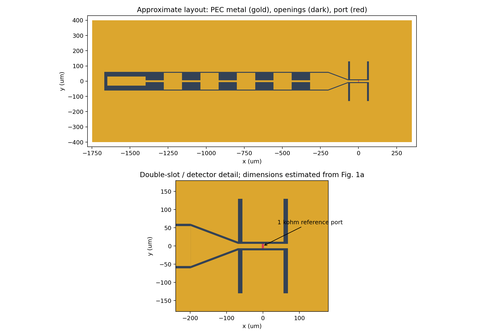
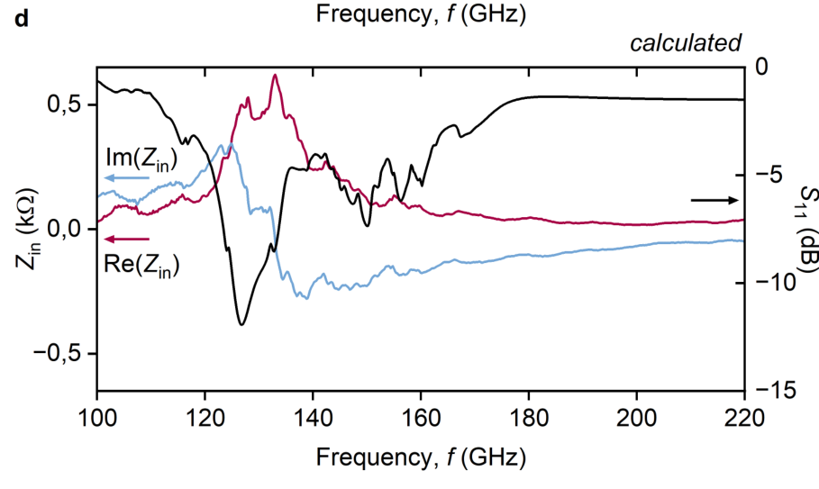

# 石墨烯双槽天线：论文图 2d 的 HFSS 近似复现

## 参数化研究：固定端口、独立扫描槽长/槽距/相对位置

[完整单文件脚本](parametric_paper_2021/build_parametric_2021.py) · [操作说明](parametric_paper_2021/README_中文.md) · [参数预览](parametric_paper_2021/parameter_preview.png) · [下载包](downloads/HFSS_parametric_2021.zip)

默认坐标保持已跑通的有限GSG模型不变，加入真正驱动几何的3个变量和3组独立一维扫描；端口仍固定在x=0。建议先验算名义基线，再只跑5组槽长。新脚本尚未在HFSS实机运行。


## 中文PPT：结构设计与仿真思路

[42页 PowerPoint](presentations/Graphene_THz_HFSS_Simulation_Guide.pptx) · [PDF预览](presentations/Graphene_THz_HFSS_Simulation_Guide.pdf) · [目录与讲解备注](presentations/README.md)

包含论文依据、HFSS逐项设置的原因、用户扫参结果和复现条件核对，明确区分旧模型结果与尚未求解的新版。


## 当前建议：先核对论文中的有限 GSG 版图

旧版大矩形地模型与论文显微图存在差异，其槽长扫描不能视为原文数据复现。已单独加入 [论文版图核对版](paper_layout_2021/README_中文.md)：

- [新版单文件建模脚本](paper_layout_2021/build_paper_layout_2021.py)
- [有限 GSG 轮廓预览](paper_layout_2021/layout_preview.png)
- [下载新版包](downloads/HFSS_paper_layout_2021.zip)

恢复有限 GSG 焊盘和渐变、加入 300 nm 氧化层。**这仍是图片估计尺寸的结构核对版，尚未在 HFSS 中执行，也未复现图2d数值。** 精确复现所缺的作者尺寸、端口与材料条件见新版说明。旧版本保留以便回溯。


本仓库提供按论文显微图估计尺寸的 HFSS 参数化建模脚本，目标为 100–220 GHz 的输入阻抗与 S₁₁。

**尚未进行 HFSS 全波求解。** 当前已完成 Python 语法、PyAEDT 0.18.1 接口核对和二维导体连通性检查；不代表 HFSS 内建模或求解已验证，也不保证与论文曲线重合。

- [中文运行说明](hfss/README_中文.md)
- [下载完整脚本包](downloads/HFSS_fig2d.zip)（打开后点击 Download raw file；也可用仓库 Code → Download ZIP）
- [建模脚本](hfss/build_hfss.py)
- [参数文件](hfss/parameters.json)
- [结果绘图脚本](hfss/plot_results.py)

## HFSS 2021 R1 用户

请使用新增的 **AEDT 内置脚本**，不要运行 PyAEDT 脚本或安装其 requirements：

1. [下载 HFSS_2021R1.zip](downloads/HFSS_2021R1.zip) 并解压。
2. 在 HFSS 菜单 Tools → Run Script 中运行 `hfss_2021/build_2021.py`，只建模。
3. 检查模型后，在同一设计中运行 `hfss_2021/solve_export_2021.py`，求解并导出报告。

[2021 R1 详细说明](hfss_2021/README_2021R1.md)。原生脚本已通过 Python 2 语法和几何一致性检查，**尚未在 HFSS 2021 R1 实机验证**。

## 近似版图预览

下图是建模预览，不是仿真场图或计算结果。



## 论文对照图

图片来自用户提供的论文 arXiv:2603.03554v3，仅用于核对目标和结构，不是本次仿真结果。



## 新版 HFSS 的 PyAEDT 运行方式（不适用于 2021 R1）

需要可用的 AEDT/HFSS 安装和许可证，推荐独立 CPython 3.11。详细的安装、建模、求解和收敛检查步骤见中文说明。

```powershell
cd hfss
python -m pip install -r requirements.txt
python build_hfss.py --dry-run --output preview
python build_hfss.py --aedt-version 2025.1 --output model_01
python build_hfss.py --aedt-version 2025.1 --solve --cores 4 --output run_01
python plot_results.py run_01
```

请将 AEDT 版本替换为本机版本。首次先只建模，检查端口与几何后再求解。
