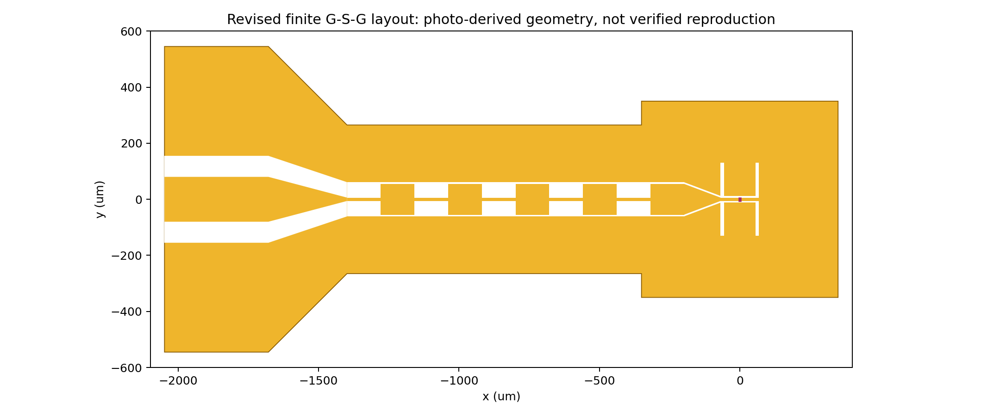

# 论文版图核对版：HFSS 2021 R1

**这是按论文图像重建的结构核对模型，尚未复现图 2d 的数值数据。** 原矩形地模型的槽长扫描不能作为论文复现结果。本目录单独保存新模型，避免与旧模型混淆。

## 本次修正

旧版：大矩形地、左端封闭式开口与简化信号条，省略有限 GSG 焊盘外轮廓；硅直接接触金属面。

新版：

- 按原图恢复上下展开的 G 焊盘、中间 S 焊盘、GSG 渐变过渡、扼流区窄地、右侧天线金属平台。
- 左侧 CPW 开口延伸到版图边缘，不再用矩形地包围信号焊盘末端。
- 保留五个宽段与相邻窄段、渐变馈线和双槽；未根据之前的曲线人为改变槽长来追求低谷重合。
- 显式加入正文给出的 300 nm SiO2，置于 z=-0.3…0 μm；金属和端口位于 z=0。硅顶面改为 z=-0.3 μm。
- 三个介质盒的辐射边界只在外表面，共 14 面，内部空气/氧化层与氧化层/硅界面不赋辐射边界。
- 保留已修复的 HFSS 2021 R1 对象名、真空 SolveInside=True 和数值型带单位积分线。

预览仅显示金属平面，不是仿真场或仿真结果。整体转动 90° 本身不是前后模型差异；有限地轮廓、渐变与端部条件才是需要核对的内容。

## 来源与可靠程度

来源为用户上传 arXiv:2603.03554v3 的图 1a、图 2d、正文与 Methods。图 1a 显微图的 500 μm 标尺用于估计宏观轮廓；照片内的放大插图不是同一比例，不用于尺寸标定。边缘被标注、放大框与圆圈遮挡的地方仍存在不确定性。

| 条件 | 状态 |
|---|---|
| 双槽、CPW、交替高低阻抗扼流结构 | 原文明确描述，宏观拓扑按图像重建 |
| Si 电阻率约 100 Ω·cm | 原文给出；换算为 1 S/m |
| SiO2 厚度 300 nm | 原文给出，已加入 |
| 低阻抗段缝隙 6 μm | 原文给出，用于宽段缝隙 |
| 槽长 260 μm、槽距 125 μm、其他尺寸 | 图片估计，不能当作作者尺寸 |
| 探测器间隙 6 μm | 模型假设；不是正文给出的沟道长度 |
| 硅 εr=11.7，SiO2 εr=3.9、氧化层损耗为0 | 初始材料假设，不是原作者完整参数 |
| Cr 3 nm / Au 80 nm | 原文给出；本结构核对版仍用 PEC，尚未实现薄膜损耗 |
| 石墨烯电阻约 1 kΩ | 原文给出；目前用 1000 Ω 参考端口提取馈点阻抗，没有并联重复负载 |
| 硅片厚度、透镜尺寸及是否进入图2d计算 | 当前附件无法确定；仍以延伸到边界的硅介质近似半空间 |
| CPW 另一端负载 | 当前附件无法确定；本版左端仍开路，不能认定与作者一致 |
| 作者的端口位置、参考面和 S11 归一化 | 当前附件无法确定；本版采用石墨烯位置的端口、参考1000 Ω |
| hBN厚度、齿形、石墨烯复电导 | 没有足够参数，未加入 |

正文的 λ/2 与 λ/4 描述不能唯一确定所有实际几何尺寸或有效波长；当前图片估计并没有证明满足作者的电长度条件。需要作者版图或明确尺寸来消除这一差异。

## 运行

1. 在可写英文路径下保存 `build_paper_layout_2021.py`。
2. 在 HFSS 2021 R1 点击 Tools → Run Script，运行该文件。无需 PyAEDT 或额外脚本。
3. 它新建 `Fig2d_paper_layout_2021` 设计，不修改旧工程、不自动求解。
4. 在脚本旁的 run_时间目录保存 `Graphene_PaperLayout_2021.aedt`、build_log.txt、validation.log。
5. 初次只核对版图、材料层、端口与边界。确认后可右键 Setup220 → Analyze，或运行本目录的 `solve_export_paper_2021.py`。

300 nm 氧化层与毫米级计算域的尺度差异可能增加网格成本。初次运行前保存其他工程，保留仿真日志；不能通过删去氧化层并沿用同一模型名来声称完整材料模型成立。

本版几何参数集中在脚本顶部 P 字典中；修改后应新建工程。不是 Optimetrics 参数化版。

## 复现图2d还缺什么

需要把作者结构与作者计算条件同时对齐，然后才比较 Re(Zin)、Im(Zin)、S11 三条曲线。图形轮廓接近、单个低谷接近130 GHz，都不足以证明数值复现。

精确复现目前的外部阻碍是缺少原始 CAD/完整尺寸、端口和终端定义、衬底/透镜计算条件及薄膜材料模型。只有正文和显微图时，问题并不唯一：多种尺寸和边界组合可能给出类似的一条 S11 曲线。

下一阶段应保存实际新模型结果、逐组收敛与离散点，核对阻抗与S参数的同端口一致性，再分析参数敏感性。未补齐原始条件前，结果应称为“按图像重建模型的仿真”，不能称为“已精确复现作者数据”。

## 已做的验证

- 两个原生脚本通过 Python 2 语法解析。
- 1 μm 栅格的二维几何检查：两块互不短接的导体、左右 G 焊盘与右地连通、S 焊盘经扼流区连通到馈点、端口断口保持空隙。
- 原生 HFSS 建模、氧化层网格、14面辐射边界及求解：云端没有商业求解器，尚未执行。

`verify_geometry.py` 是可选的 CPython 检查程序，需要 numpy/scipy/matplotlib，不在 HFSS 内运行；它不代替 HFSS 几何/网格或电磁验证。
