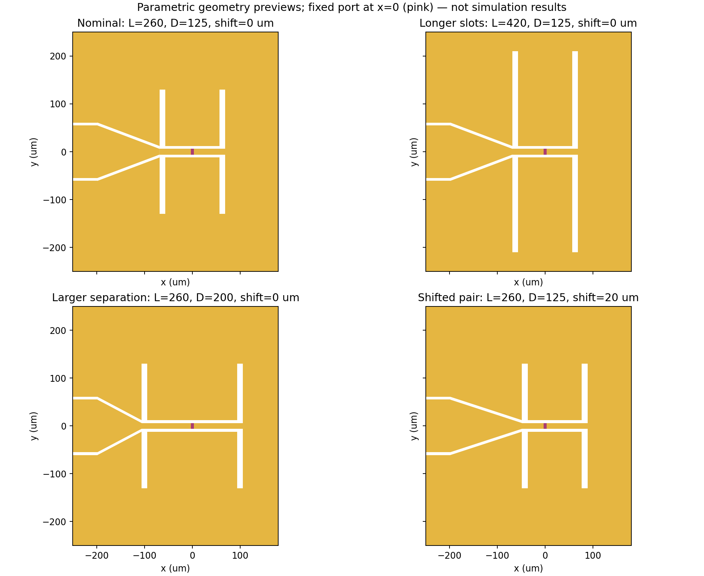

# HFSS 2021 R1：固定端口的局部天线参数化模型

这是上一版有限 GSG 版图的参数化版本。**默认几何坐标与上一版一致**，保留 PEC、300 nm SiO2、硅参数、读出端开路、1000 Ω参考端口和边界设置，用于判断几何参数对约171 GHz低谷的影响。不是已经优化到130 GHz的模型，也不代表已精确复现论文。

## 直接运行

打开 `build_parametric_2021.py`，将全文另存为同名 `.py` 文件；在 HFSS 2021 R1 选择 Tools → Run Script。它是完整单文件，不依赖旧脚本、PyAEDT或当前活动工程。

脚本新建 `Fig2d_parametric_2021`，在脚本旁 run_时间目录保存 `Graphene_Parametric_2021.aedt`。**不自动求解，不改动旧工程。** 成功时 Message Manager 显示 `PARAMETRIC BUILD COMPLETE`。

## 三个变量的定义

| HFSS变量 | 默认值 | 几何意义 |
|---|---:|---|
| slot_L | 260 μm | 两槽总长度；改变远端端点，中心馈线宽度保持不变 |
| slot_D | 125 μm | 两槽中心间距；槽中心分别为 slot_shift ± slot_D/2 |
| slot_shift | 0 μm | 双槽相对固定端口的整体X向平移；正值向+X移动 |

端口始终位于 x=0，积分线为 -3um 到 +3um；端口间隙不参与这三个扫描。这样保留了修复后的2021 R1数值积分线，不会因移动端口而失去连接。

槽中心到端口中心的距离分别为：

- 左槽距离：slot_D/2 − slot_shift。
- 右槽距离：slot_D/2 + slot_shift。

`slot_shift` 不是沿用旧模型中假设的“探测器到槽等于λ/4”的结论，它只是一项明确的几何对照变量；有效电长度需要全波结果支持。

为了接上移动后的槽，局部渐变段末端与中心馈线长度会相应变化。**焊盘、扼流段位置、有限地外轮廓、天线平台和计算域保持固定**。这些锚点按原基线D=125 μm冻结，避免扫槽距时整个器件一起平移或拉长。

## 按顺序计算

### 1. 先确认变量确实驱动几何

在设计名上右键 → Design Properties，或从HFSS菜单打开Design Properties。应看到三个Local Variables。

临时把 slot_L 改为300um，确认槽端对称变长；恢复260um。再把 slot_D 改为150um，确认两槽分开而焊盘/扼流不动；恢复125um。最后把 slot_shift 改为10um，确认双槽向+X移动、粉色端口留在原位；恢复0um。

原生变量已关联CreatePolyline坐标表达式，不需要手工修改四个槽的历史顶点。修改变量时几何重建可能花费少量时间。

### 2. 只运行名义基线

确认 slot_L=260um、slot_D=125um、slot_shift=0um。右键 Analysis → Setup220 → Analyze。

本版包括：

- Sweep100_220：100–220GHz，插值输出241点。
- CheckDiscrete：100–220GHz，间隔10GHz，共13点。
- FieldCheck：130和171GHz两个离散频点，SaveFields=True。

先检查收敛与S11/Z。若名义曲线与上一模型约171GHz低谷明显不同，先核对模型、求解和终端，不要继续扫参。坐标一致并不保证数值求解逐位一致。

### 3. 第一轮只运行SlotLengthSweep

脚本已在 Optimetrics 下创建三个**互相独立的一维扫描**：

| 扫描名称 | 变化参数 | 取值 | 其余参数 |
|---|---|---|---|
| SlotLengthSweep | slot_L | 260、300、340、380、420 μm | D=125、shift=0 |
| SlotDistanceSweep | slot_D | 100、125、150、175、200 μm | L=260、shift=0 |
| SlotShiftSweep | slot_shift | −20、−10、0、10、20 μm | L=260、D=125 |

右键 Optimetrics → SlotLengthSweep → Analyze。**不要点击全工程Analyze All**，否则可能启动所有扫描。第一轮只需要五组槽长。

这些扫描不是三参数125组的组合扫描。每个扫描显式记录默认StartingPoint；运行前仍建议检查其中两个未扫描参数的设置。每个变体需要新的几何与网格，未强制使用旧网格。

参数扫描的SaveFields=False用于控制存储量。基线FieldCheck保留场；不能假定各扫描变体的场都能事后打开。最终候选参数需恢复到对应值后单独求解并保存场。

### 4. 画五条S11和阻抗曲线

Results → Create Modal Solution Data Report → Rectangular Plot。

- Solution：Setup220 : Sweep100_220。
- 横轴Freq；S Parameter → S(Graphene,Graphene) → dB。
- Families：slot_L选All，slot_D固定125um，slot_shift固定0um。
- New Report。

Z曲线同样设置Families，Category改为Z Parameter，Quantity选Z(Graphene,Graphene)，Function分别re、im。

只看130GHz的值或全局最小值都不够。应跟踪原高频低谷所在分支，同时比较实部、虚部，以及低谷是否变浅/出现分支切换。

## 核对与限制

- 已验证名义几何与上一版的每个多边形坐标一致。
- 125个预设范围组合通过几何约束检查；21个一维样本/角点组合通过4μm栅格的二维连通性检查。
- 所有三个变量实际出现在几何坐标表达式中；积分线仍为带单位数值。
- 已通过Python2语法解析；Optimetrics载荷按原生接口结构准备。
- **云端没有HFSS 2021 R1，尚未执行新版建模、Optimetrics或求解。** 上述检查不能代替HFSS验证。

如果脚本停在创建Optimetrics阶段，核心模型已先保存；保留build_log.txt和报错，不必反复新建工程。旧版API可能需要按实际错误调整设置。

本版不调整金属损耗、IF端负载或透镜条件，也没有声称作者端口定义已经确定。这些物理假设应在几何敏感性研究之外独立验证。预设范围之外的组合没有保证；改变参数时需避免槽碰到端口、渐变倒置、槽超出金属平台。
